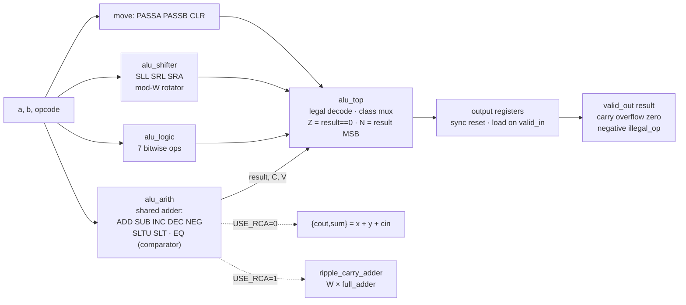

# Parameterized ALU — Structural Arithmetic and Synthesis Analysis

A registered, parameterized ALU (default 10-bit) written in **Verilog-2001 only**. It
supports 23 operations and has precisely specified status flags. The repo includes a
self-checking testbench with an independent reference model, formal equivalence proofs, and
mutation testing. Yosys synthesis compares a behavioral `+` adder against a
structural ripple-carry adder.

Every number in this README comes from a log in [`results/`](results/) that
`make all` regenerates. Nothing was run on FPGA hardware, and no timing or power numbers
exist. See [Limitations](#11-limitations).

---

## 1. Project overview

| | |
|---|---|
| Language | Verilog-2001 (RTL, testbenches, reference model, formal wrappers) |
| Width | `DATA_WIDTH` parameter, default 10, verified at 8 / 10 / 16 |
| Interface | one-cycle registered, `valid_in` → `valid_out`, synchronous active-low reset |
| Operations | 8 arithmetic/compare, 7 logic, 5 shift/rotate, 3 data movement |
| Flags | `carry`, `overflow`, `zero`, `negative`, `illegal_op` |
| Adder variants | `USE_RCA=0` behavioral `+`, `USE_RCA=1` structural ripple-carry |
| Tools | Icarus Verilog 12.0, Yosys 0.33, Verilator 5.020 (lint only), GTKWave |

## 2. Objectives and design motivation

The goal is to show *correct* RTL, not a large amount of it:

- **Flags designed up front.** Carry vs signed overflow, the subtract-borrow convention,
  and the illegal-opcode behavior are specified per operation, then tested.
- **One variable at a time.** The behavioral and structural configurations
  share every line of RTL except the adder, so a synthesis difference can
  only come from the adder.
- **Verification that can fail.** A bug-injection run shows the testbench catches
  11 out of 11 deliberately introduced bugs. A testbench that only ever passes
  proves nothing.
- **Hypotheses before measurement.** The [specification](docs/specification.md)
  recorded predictions before synthesis ran. Section 10 reports which ones held and one
  that did not.

## 3. Supported operations

`opcode[4:3]` selects the class and `opcode[2:0]` the operation. The 9 unused codes are illegal.

| Opcode | Op | Result | C | V |
|---|---|---|:-:|:-:|
| `00_000` | ADD | A + B | carry-out | ✓ |
| `00_001` | SUB | A − B = A + ~B + 1 | **1 = no borrow** | ✓ |
| `00_010` | INC | A + 1 | carry-out | ✓ |
| `00_011` | DEC | A − 1 | **1 = no borrow** | ✓ |
| `00_100` | NEG | 0 − A | **1 = no borrow** (A = 0) | ✓ |
| `00_101` | SLTU | 1 if A < B unsigned, else 0 | 0 | 0 |
| `00_110` | SLT | 1 if A < B signed, else 0 | 0 | 0 |
| `00_111` | EQ | 1 if A == B, else 0 | 0 | 0 |
| `01_000`–`01_110` | AND OR XOR NOT NAND NOR XNOR | bitwise (NOT uses A only) | 0 | 0 |
| `10_000` | SLL | A << B, zero fill | 0 | 0 |
| `10_001` | SRL | A >> B, zero fill | 0 | 0 |
| `10_010` | SRA | A >>> B, sign fill | 0 | 0 |
| `10_011` / `10_100` | ROL / ROR | rotate by B mod W | 0 | 0 |
| `11_000` / `11_001` / `11_010` | PASSA / PASSB / CLR | A / B / 0 | 0 | 0 |
| `01_111`, `10_101`–`10_111`, `11_011`–`11_111` | *illegal* | 0, `illegal_op = 1` | 0 | 0 |

The **shift amount is the full unsigned value of B**. SLL/SRL by ≥ W give 0, SRA by ≥ W
gives all sign bits, and rotates use B mod W. Compare results are a 1-bit Boolean
zero-extended to W bits.

## 4. Module architecture



| File | Contents |
|---|---|
| [`rtl/alu_top.v`](rtl/alu_top.v) | decode, result mux, Z/N/illegal, output registers |
| [`rtl/alu_arith.v`](rtl/alu_arith.v) | operand select → **one shared adder** → C, V, SLT/SLTU; EQ comparator |
| [`rtl/alu_logic.v`](rtl/alu_logic.v) | bitwise operations |
| [`rtl/alu_shifter.v`](rtl/alu_shifter.v) | shifts; rotate-left chain reused for ROR via bit reversal |
| [`rtl/ripple_carry_adder.v`](rtl/ripple_carry_adder.v), [`rtl/full_adder.v`](rtl/full_adder.v) | structural adder (generate loop of gate-level full adders) |
| [`rtl/alu_opcodes.vh`](rtl/alu_opcodes.vh) | opcode `localparam`s, `` `include``d inside modules (Verilog-2001 has no packages) |
| [`tb/tb_alu.v`](tb/tb_alu.v) | self-checking ALU testbench + reference model |
| [`tb/tb_ripple_carry_adder.v`](tb/tb_ripple_carry_adder.v) | exhaustive / random adder testbench |
| [`formal/equiv_wrappers.v`](formal/equiv_wrappers.v) | wrappers that give the two configurations distinct names for the Yosys proofs |
| [`scripts/`](scripts/) | Yosys scripts, sim runner, Verilog-2001 guard, mutation test, GTKWave layout |

Two design points that aren't obvious from the code:

- **Shared adder.** Every arithmetic op and both "less-than" compares use the same
  `x + y + cin` adder, with operands selected per opcode (SUB: `y = ~b, cin = 1`;
  DEC: `y = all ones`; NEG: `x = 0, y = ~a, cin = 1`). SLT is `sum[MSB] ^ V`,
  not the sign bit alone: −512 − 1 wraps to +511, so its sign bit says "not less than".
- **Rotate by B mod 10 without a divider.** Rotations add modulo W, so stage *k* of
  the rotator rotates by the constant `2^k mod W` when `B[k]` is set. That gives 10 mux
  stages and no division, for any width.

## 5. Interface timing and reset

At each rising edge, in priority order:

1. `rst_n == 0`: `valid_out`, `result` and all flags become 0. **Reset takes priority over `valid_in`.**
2. `valid_in == 1`: `a`, `b`, `opcode` are sampled. After this edge, `valid_out = 1` and the
   result and flags belong to that transaction. **Latency 1, throughput 1 per cycle.**
3. otherwise: `valid_out = 0`, and **result and flags hold** their last values. Inputs are ignored and may be X.

There is no backpressure. Outputs come directly from flip-flops. They are X until the first clocked reset.

| Edge | `rst_n` | `valid_in` | inputs | → `valid_out` | → `result` / flags |
|---|---|---|---|---|---|
| E0 | 0 | X | X | 0 | 0 / all 0 |
| E1 | 0 | 1 | T0 | 0 | 0, T0 discarded (reset wins) |
| E2 | 1 | 1 | ADD 0x1FF, 0x001 | 1 | 0x200 / V=1 N=1 |
| E3 | 1 | 1 | SUB 5, 5 | 1 | 0x000 / C=1 Z=1 (back-to-back) |
| E4 | 1 | 0 | X | **0** | 0x000 / C=1 Z=1 **held** |
| E5 | 1 | 1 | opcode `01_111` | 1 | 0 / `illegal_op=1`, other flags 0 |
| E6 | 0 | 0 | X | 0 | 0 / all 0 (mid-stream reset) |

## 6. Flag definitions and arithmetic conventions

- `zero = (result == 0)` and `negative = result[MSB]` for every **legal** op, including logic,
  shift and move results, as with the ARM N/Z flags.
- `carry` is the **physical adder carry-out** for ADD/SUB/INC/DEC/NEG. So for
  subtraction, **carry = 1 means no borrow** (A ≥ B unsigned). This is the ARM/6502 convention;
  x86 uses the opposite. The same wire serves all five ops with no polarity inversion.
- `overflow` is two's-complement overflow: `(x[MSB] == y[MSB]) && (sum[MSB] != x[MSB])`
  on the adder's actual inputs. That equals carry-into-MSB XOR carry-out-of-MSB for any `cin`.
- Illegal opcode: result 0, **all** status flags 0 (including `zero`), `illegal_op = 1`.

| W = 10 example | Result | C | V | What it shows |
|---|---|:-:|:-:|---|
| ADD 0x1FF + 0x001 | 0x200 | 0 | 1 | signed overflow with no carry |
| ADD 0x3FF + 0x001 | 0x000 | 1 | 0 | carry with no overflow, Z = 1 |
| SUB 0x000 − 0x001 | 0x3FF | 0 | 0 | borrow (C = 0) |
| SUB 0x200 − 0x001 | 0x1FF | 1 | 1 | −512 − 1 overflows |
| NEG 0x200 | 0x200 | 0 | 1 | −(−512) is not representable |

## 7. Structural adder

[`full_adder`](rtl/full_adder.v) is written as gate equations: `sum = a ^ b ^ cin`,
`cout = (a & b) | ((a ^ b) & cin)`. [`ripple_carry_adder`](rtl/ripple_carry_adder.v) chains
`WIDTH` of them through a `WIDTH+1`-bit carry vector with a `generate for` loop, so
`{cout, sum}` is exactly `a + b + cin`. Subtraction uses the identity
`A − B = A + ~B + 1`: the inverted operand goes into `y` and the "+1" goes into `cin`.

## 8. Verification methodology

Details are in [`docs/verification.md`](docs/verification.md).

- **Scoreboard checks every cycle.** It doesn't wait for transactions. It models the output
  registers (reset, accept, or hold) and compares all 7 outputs 1 ns after each edge,
  so latency, valid timing and hold behavior are all checked by the same code.
- **Independent reference model.** It computes overflow as an integer range check
  (the RTL uses the sign-bit rule), carry/borrow by comparing integers, and shifts and rotates
  with bit-by-bit loops. It shares nothing with the RTL except the opcode values.
- **The model is checked too.** 34 hand-written vectors from the spec are compared against the
  reference model *before* the DUT is checked against it.
- **Stimulus:**
  - directed: all 32 opcodes × 10 corner operands squared
  - shifts: amounts {0, 1, W−1, W, W+1, 2W, 2^W−1}, plus every rotate amount 0…1023
  - interface: reset-with-valid, mid-stream reset, gaps of 1/3/5, back-to-back, X inputs while idle
  - 20,000 constrained-random cycles: ~75% valid, ~10% illegal opcodes, 25% corner operands, rare random resets
- **Event counters:** per-opcode, carry/borrow, both overflow directions per op, zero per class,
  shift-amount bins, interface scenarios. Any required counter at 0 is a *hole* and **fails the run**.
  These counters are not SystemVerilog functional coverage. They count only what was
  chosen in advance.
- **Exit status:** Verilog-2001 has no `$fatal` and `$finish` takes no exit code. So the testbench
  calls `$stop` on failure, and `vvp -N` turns that into exit status 1. Plain `vvp` would
  open an interactive prompt and exit 0. [`scripts/run_vvp.sh`](scripts/run_vvp.sh) also
  requires the `TEST PASSED` line.
- **Formal equivalence** ([`scripts/equiv.ys`](scripts/equiv.ys)): Yosys SAT proves that
  `ripple_carry_adder` equals `a + b + cin` for all 2^21 inputs. Temporal induction proves that
  the full behavioral and structural ALUs give identical outputs in every state reachable from reset.
- **Verilog-2001 enforcement:** `iverilog -g2001` was measured to *accept* `logic`,
  `$urandom` and `$fatal`. So `make lint` adds Verilator in `1364-2001` mode plus a
  token guard ([`scripts/check_v2001.sh`](scripts/check_v2001.sh)).

## 9. Test results (measured)

| Check | Result |
|---|---|
| `make lint`: Verilator `-Wall`, both configs, + 2001 token guard on 10 files | 0 warnings |
| `tb_alu`, W = 8 / 10 / 16 × `USE_RCA` = 0 / 1 (6 runs) | **all pass**, 0 holes |
| ↳ W = 10, each config | 25,491 cycles checked, 20,469 transactions, 0 failures |
| `tb_ripple_carry_adder` W = 10, exhaustive | **2,097,152 / 2,097,152** vectors correct |
| `tb_ripple_carry_adder` W = 1, 4 (exhaustive), 16 (200,072 corner + random) | all pass |
| Formal: RCA ≡ `a+b+cin`; behavioral ALU ≡ structural ALU | **proven** (SAT, 1-step induction) |
| Formal sanity: same proof on an ALU with a broken full adder | fails, as it should |
| Mutation test: 11 injected bugs | **11 / 11 detected** |
| Extra seeds 1, 42, 987654 | pass |

The bugs injected by the mutation test ([`results/mutation.log`](results/mutation.log)) were chosen to be realistic:

- overflow computed from raw `b` instead of `~b`
- SLT without the overflow correction
- carry polarity inverted
- SRA operand left unsigned (`>>>` becomes a logical shift)
- wrong rotator constants
- `zero` not gated on illegal opcodes
- no hold on idle
- `valid_out` stuck at 1
- reset not clearing `result`
- full-adder carry ignoring `cin`
- RCA dropping carry-in

## 10. Synthesis methodology and results (measured)

**Method:** the same RTL and the same Yosys 0.33 script in each flow; only
`chparam -set USE_RCA` differs. All flows flatten the design and run `check -assert`
(no problems found). Three flows are used: generic gates, and the `synth_ice40` and
`synth_xilinx` FPGA mappings. These are **resource counts before place-and-route,
not timing.** Columns are compared only within a flow. Full tables:
[`results/synth/summary.md`](results/synth/summary.md). Discussion:
[`docs/synthesis.md`](docs/synthesis.md).

| W = 10 | Behavioral `+` | Structural RCA | Δ (RCA − behav) |
|---|---:|---:|---:|
| **Whole ALU, generic:** total cells | 970 | 949 | −21 (−2.2%) |
| ↳ longest path, `ltp` (cells) | 33 | 42 | +9 |
| **Whole ALU, iCE40:** SB_LUT4 | 387 | 410 | +23 |
| ↳ SB_CARRY | 10 | 0 | −10 |
| **Whole ALU, Xilinx 7:** LUTs | 316 | 311 | −5 |
| ↳ CARRY4 | 3 | 0 | −3 |
| Flip-flops (every flow) | 15 | 15 | 0 |
| **Adder alone, generic:** cells / longest path | 66 / 12 | 50 / 21 | −16 / +9 |
| **Adder alone, iCE40:** LUT4 + SB_CARRY | 10 + 10 | 23 + 0 | |
| Synthesis warnings | 0 | 0 | |

### Measured results vs expectations

| Prediction (made before synthesis, [spec §7.4](docs/specification.md)) | Measured outcome |
|---|---|
| iCE40 maps behavioral `+` onto the `SB_CARRY` chain; the gate-level RCA can't use it, so it needs more LUTs | **Confirmed:** 10 SB_CARRY vs 0, +23 LUT4 for the whole ALU. *Speed not measured* (no place-and-route) |
| Generic `$alu` lowering is a parallel-prefix carry unit, so behavioral uses more cells but has less depth | **Confirmed.** Yosys `techmap.v` (`_90_lcu`) is a Brent–Kung adder. Adder alone: 66 vs 50 cells, depth 12 vs 21 |
| 16 flip-flops (10 result + 5 flags + valid) | **Wrong: 15.** `negative` is defined as `result[MSB]`, so Yosys merged the two registers (`assign result[9] = negative;` in the netlist). The N flag costs no hardware |
| ABC might wipe out the ripple structure after flattening | Not fully: the RCA's 21-cell depth (~2 per bit) suggests a ripple chain survived |

**Interpretation.** At W = 10 the adder choice changes the whole ALU by only about 2% in cells.
The shifter is 44% of the logic and the adder is a small part of `alu_arith`
([per-unit table](results/synth/summary.md)). The structural RCA gives the
classic trade: fewer gates, but a longer chain of gates. On FPGAs, writing `+` lets the tool
use the dedicated carry logic, and hand-written full adders prevent that. So
"structural" is not automatically smaller or faster. Which is better depends on the target, and the
data here doesn't support a speed claim either way.

## 11. Limitations

- **No timing, Fmax, or power results.** No place-and-route or STA tool is installed. `ltp`
  counts cells on the longest path. It is a depth proxy and is only meaningful for the generic
  netlist, because `ltp` treats mapped FPGA flip-flops as logic. **No FPGA board testing was done.**
- Generic cell counts are not area. FPGA counts are before place-and-route and not vendor-tool results.
- The equivalence proof shows behavioral ≡ structural at W = 10. Correctness *against
  the spec* comes from simulation (directed + golden + random), which is not exhaustive for the full ALU.
- Event counters are not functional coverage (no crosses, only pre-chosen events).
- The reference model uses 32-bit integers, so the testbench supports `DATA_WIDTH` ≤ 30.
  The RTL needs `DATA_WIDTH` ≥ 2 and stops elaboration otherwise.
- The Verilog-2001 guard is a keyword/token scan. It complements, and doesn't replace, a
  strict 2001-only parser.
- No backpressure (`ready`). An X on `valid_in` itself is not handled.

## 12. Reproduction

Prerequisites: `iverilog` (12.0), `yosys` (0.33), `verilator` (5.x, lint only), `gtkwave`, GNU make, bash.

```sh
make all          # lint + 10 simulations + formal + mutation + synthesis   (~75 s here)
make lint         # Verilator -Wall in 1364-2001 mode + SystemVerilog token guard
make sim          # tb_alu at W=10 with both adder configurations
make test         # full simulation matrix
make test SEED=42 NUM_RANDOM=100000
make formal       # prints "EQUIVALENCE PROVEN"
make mutation     # prints "mutants: 11, killed: 11, survived: 0"
make synth        # writes results/synth/*.log and summary.md
make waves        # build/tb_alu.vcd from a short run
make gtkwave      # opens it with scripts/tb_alu.gtkw
```

Under the hood, a single simulation is:

```sh
iverilog -g2001 -Wall -Irtl -s tb_alu -P tb_alu.USE_RCA=1 -o build/tb.vvp \
    rtl/full_adder.v rtl/ripple_carry_adder.v rtl/alu_arith.v rtl/alu_logic.v \
    rtl/alu_shifter.v rtl/alu_top.v tb/tb_alu.v
vvp -N build/tb.vvp +seed=20261028          # exit status 1 on any failure
```

A successful run ends with `TEST PASSED`. A failing run prints, for each mismatch, the check
number, transaction number, test section, opcode, operands, and the expected and actual values of
`valid_out`, `result` and every flag, followed by `TEST FAILED (...)`.

**In GTKWave** (`make gtkwave`): `valid_out` should be high in the clock cycle
right after each cycle where `valid_in` was high and `rst_n` was high. Both are sampled
on the same rising edge, so `valid_out` rises on the edge that ends the request cycle. `result` and the flags should change only on those
edges and stay unchanged across idle gaps. Everything should go to 0 at an edge where `rst_n` is low,
even if `valid_in` is high. The saved layout also shows the scoreboard's `exp_valid`/`exp_vec`
under the outputs, so a mismatch is visible as the two groups disagreeing.

## 13. Future improvements

- **Share one shifter.** SLL, SRL and SRA are three separate barrel shifters, and the shifter is 44%
  of the logic. Bit reversal (already used for ROR) would let one right-shifter do all three.
- Add a third adder (Kogge–Stone or carry-select) and sweep `DATA_WIDTH` to plot cells and depth vs W.
- Get real timing with nextpnr + icestorm (iCE40) or a vendor tool. Until then, no speed claim is made.
- Optional pipeline stage with `ready`/`valid` backpressure.
- A multiplier (array vs Booth), compared with the same method.
