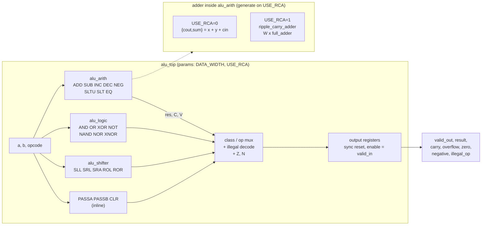

# Stage 1 — Specification: Parameterized ALU (Verilog-2001)

Status: **draft, awaiting review**. Nothing in this document has been implemented
yet. Every "expected" number below is a prediction, not a measurement.

---

## 1. Requirements summary

| # | Requirement | Where it is addressed |
|---|-------------|-----------------------|
| R1 | Verilog-2001 only (RTL, testbenches, reference model) | §9 language guard |
| R2 | Parameter `DATA_WIDTH`, default 10 | §5 |
| R3 | One-cycle registered interface, synchronous active-low reset | §4 |
| R4 | 23 operations: 8 arithmetic/compare, 7 logic, 5 shift/rotate, 3 move | §2 |
| R5 | Flags `carry`, `overflow`, `zero`, `negative`, `illegal_op` with per-op definitions | §3 |
| R6 | Parameterized structural ripple-carry adder, independently tested | §5.3, §6.2 |
| R7 | Second ALU configuration using the structural adder, functionally equivalent | §5.4 |
| R8 | Self-checking testbench, independent reference model, nonzero exit on failure | §6 |
| R9 | Yosys synthesis of both variants with a fair, documented comparison | §7 |
| R10 | README, docs, reproducible scripts, measured results only | Stage 7 |

### Environment (verified on this machine, 2026-10-28)

| Tool | Version | Use |
|------|---------|-----|
| Icarus Verilog | 12.0 (stable) | simulation (`iverilog -g2001`, `vvp`) |
| Yosys | 0.33 (git 2584903a060) | synthesis, formal equivalence |
| Verilator | 5.020 | Verilog-2001 syntax lint only (not used for simulation) |
| GTKWave | installed | waveform viewing |
| GNU Make | 4.3 | automation |

Not installed: nextpnr, icetime, OpenSTA, and the qflow standard-cell library.
So **no real timing (Fmax) numbers can be produced** on this machine (see §7.5).

---

## 2. Opcode table

`OPCODE_WIDTH = 5` (32 codes, 23 legal, 9 illegal). The two MSBs select the
operation class, so the decode is a 4-way class mux followed by a small
per-class mux. The encoding is also easy to read in a waveform.

| Opcode | Mnemonic | Class | Result (W = `DATA_WIDTH`) | Operands used |
|--------|----------|-------|---------------------------|---------------|
| `00_000` | `ADD`   | arith | `A + B` (mod 2^W) | A, B |
| `00_001` | `SUB`   | arith | `A - B` (mod 2^W) | A, B |
| `00_010` | `INC`   | arith | `A + 1` | A |
| `00_011` | `DEC`   | arith | `A - 1` | A |
| `00_100` | `NEG`   | arith | `0 - A` (two's complement) | A |
| `00_101` | `SLTU`  | compare | `{W-1 zeros, (A <u B)}` | A, B |
| `00_110` | `SLT`   | compare | `{W-1 zeros, (A <s B)}` | A, B |
| `00_111` | `EQ`    | compare | `{W-1 zeros, (A == B)}` | A, B |
| `01_000` | `AND`   | logic | `A & B` | A, B |
| `01_001` | `OR`    | logic | `A \| B` | A, B |
| `01_010` | `XOR`   | logic | `A ^ B` | A, B |
| `01_011` | `NOT`   | logic | `~A` | A |
| `01_100` | `NAND`  | logic | `~(A & B)` | A, B |
| `01_101` | `NOR`   | logic | `~(A \| B)` | A, B |
| `01_110` | `XNOR`  | logic | `~(A ^ B)` | A, B |
| `01_111` | —       | **illegal** | | |
| `10_000` | `SLL`   | shift | A shifted left by B, zero fill | A, B |
| `10_001` | `SRL`   | shift | A shifted right by B, zero fill | A, B |
| `10_010` | `SRA`   | shift | A shifted right by B, sign fill | A, B |
| `10_011` | `ROL`   | shift | A rotated left by (B mod W) | A, B |
| `10_100` | `ROR`   | shift | A rotated right by (B mod W) | A, B |
| `10_101`–`10_111` | — | **illegal** | | |
| `11_000` | `PASSA` | move | `A` | A |
| `11_001` | `PASSB` | move | `B` | B |
| `11_010` | `CLR`   | move | `0` | — |
| `11_011`–`11_111` | — | **illegal** | | |

Unused operands are don't-care inputs. They must not affect any output.
The testbench drives random values on them to check this.

### 2.1 Shift-amount policy (B is the shift amount)

The **full unsigned value of B** (0 … 2^W − 1) is the shift amount. B is not
truncated to `$clog2(W)` bits. For W = 10, amounts 10 … 1023 are all
representable and are tested.

| Op | Amount `s < W` | Amount `s >= W` |
|----|----------------|-----------------|
| `SLL` | `A << s` | all zeros |
| `SRL` | `A >> s` | all zeros |
| `SRA` | `$signed(A) >>> s` | all copies of `A[W-1]` (0 or all ones) |
| `ROL`/`ROR` | rotate by `s` | rotate by `s mod W` |

The SLL/SRL/SRA column matches the native Verilog semantics: a shift by
≥ width yields all fill bits. The behavioral shifter therefore needs no
special-case code. It does need `$signed` used correctly; see §5.5.

**Rotation by `s mod W` when W is not a power of two.** For W = 10, `B mod 10`
looks like it needs a divider. The plan avoids that: a log-depth rotator
where stage *k* rotates by the constant `(2^k mod W)` when `B[k]` is 1.
Rotations compose additively mod W, so the stages give a total rotation of
`B mod W`. That is W stages of W 2:1 muxes and no divider. Stage 3
implements it, and the testbench checks it against a bit-by-bit loop model.

---

## 3. Flag semantics

### 3.1 Global rules

1. `zero = (result == 0)` for every **legal** operation.
2. `negative = result[W-1]` for every **legal** operation. This applies the same
   way to logic, shift, and move results, as the ARM N flag does. For
   compares, the result is zero-extended, so `negative` is always 0 there.
3. `carry` and `overflow` are meaningful **only for `ADD SUB INC DEC NEG`**.
   For every other legal opcode both are 0.
4. Illegal opcode: `result = 0`, `carry = overflow = zero = negative = 0`,
   `illegal_op = 1`. All status flags are cleared so that a consumer that ignores
   `illegal_op` does not see a believable "result was zero" status.
5. `illegal_op = 0` for every legal opcode.

### 3.2 Carry convention: carry = adder carry-out (1 means *no borrow* on subtract)

All five arithmetic ops run through **one** W-bit adder computing
`{cout, sum} = X + Y + cin`. `carry` is always that physical `cout`.

| Op | X | Y | cin | `carry = 1` means | Overflow (`V`) condition |
|----|---|---|-----|-------------------|----------------------------|
| `ADD` | A | B | 0 | unsigned `A + B >= 2^W` | A, B same sign and result sign differs |
| `SUB` | A | ~B | 1 | **no borrow**: unsigned `A >= B` | A, B different signs and result sign ≠ A's sign |
| `INC` | A | 0 | 1 | `A == 2^W − 1` (wraps to 0) | `A == 2^(W-1) − 1` (max positive) |
| `DEC` | A | all ones | 0 | **no borrow**: `A != 0` | `A == 2^(W-1)` (min negative) |
| `NEG` | 0 | ~A | 1 | **no borrow**: `A == 0` | `A == 2^(W-1)` (−512 has no positive) |

The subtraction identity is `A − B = A + (~B) + 1` (mod 2^W). The
"+1" is the adder's `cin`. Seen as `0 − A`, NEG is a subtraction and follows
the SUB convention.

**Why carry rather than borrow:** the flag is the adder's carry-out wire for all
five ops, with no inverter and no op-dependent polarity. The
ARM and 6502 architectures use this convention. x86 uses the opposite (CF = borrow). The README will
state the convention in bold, because a reader may assume either one.

### 3.3 Overflow vs carry, with W = 10 boundary examples

| Op | A | B | Result | C | V | Point being tested |
|----|---|---|--------|---|---|--------------------|
| ADD | 0x1FF (+511) | 0x001 | 0x200 (−512) | 0 | **1** | signed overflow without carry |
| ADD | 0x3FF (−1 / 1023) | 0x001 | 0x000 | **1** | 0 | carry without signed overflow; Z = 1 |
| ADD | 0x200 (−512) | 0x200 | 0x000 | 1 | **1** | both; Z = 1 |
| SUB | 0x200 (−512) | 0x001 | 0x1FF (+511) | 1 | **1** | negative − positive overflow |
| SUB | 0x000 | 0x001 | 0x3FF | **0** (borrow) | 0 | borrow; N = 1 |
| SUB | 0x005 | 0x005 | 0x000 | 1 | 0 | equal operands: no borrow, Z = 1 |
| INC | 0x1FF | — | 0x200 | 0 | 1 | max positive → min negative |
| INC | 0x3FF | — | 0x000 | 1 | 0 | unsigned wrap |
| DEC | 0x000 | — | 0x3FF | 0 | 0 | borrow from zero |
| DEC | 0x200 | — | 0x1FF | 1 | 1 | min negative → max positive |
| NEG | 0x200 | — | 0x200 | 0 | 1 | −(−512) is not representable |
| NEG | 0x000 | — | 0x000 | 1 | 0 | −0 = 0, no borrow |

### 3.4 Compare implementation (all from the shared subtractor except EQ)

- `SLTU = ~cout` of `A − B` (a borrow means A < B unsigned).
- `SLT  = sum[W-1] ^ V` of `A − B`. A plain sign bit is wrong whenever
  the subtraction overflows. Example: −512 < 1 is true, but
  `−512 − 1` wraps to +511, so its sign bit is 0. XOR with V corrects it.
- `EQ = (A == B)` with a direct comparator, not the adder. It is
  cheaper and independent of the adder implementation. The consequence is noted in §5.4.

---

## 4. Interface protocol

### 4.1 Ports

| Port | Dir | Width | Description |
|------|-----|-------|-------------|
| `clk` | in | 1 | rising-edge clock |
| `rst_n` | in | 1 | synchronous, active-low reset |
| `valid_in` | in | 1 | transaction request |
| `a`, `b` | in | W | operands |
| `opcode` | in | 5 | operation select |
| `valid_out` | out | 1 | registered: outputs carry a new transaction |
| `result` | out | W | registered result |
| `carry`, `overflow`, `zero`, `negative`, `illegal_op` | out | 1 each | registered flags |

All outputs come directly from flip-flops, with no combinational path from input to output.
Expected register count: W + 5 flags + 1 valid = **16 flip-flops at W = 10**.

### 4.2 Rules (evaluated at each rising edge of `clk`, in priority order)

1. **Reset**: if `rst_n == 0`, then `valid_out`, `result`, and all five flags become 0.
   Reset has priority over `valid_in`. A transaction presented during reset
   is discarded.
2. **Accept**: else if `valid_in == 1`, then `a`, `b`, and `opcode` are sampled. After
   this same edge, `valid_out = 1` and `result`/flags show that transaction.
   **Latency = 1 cycle. Throughput = 1 transaction per cycle.**
3. **Idle**: else (`valid_in == 0`), `valid_out` becomes 0 and **`result` and
   flags hold their previous values**. `a`, `b`, and `opcode` are ignored and
   may be X.

There is no `ready`/backpressure. The ALU accepts every valid cycle.
Before the first clock edge with `rst_n == 0`, all outputs are X. A synchronous
reset needs a running clock, so the testbench holds `rst_n` low for at least
two edges.

**Hold vs clear when idle:** hold was chosen. The data registers become simple
enable-flops, which avoids an extra clear mux on 15 bits and reduces
output toggling. A consumer must qualify the data with `valid_out`, as in any
valid-qualified interface. The testbench checks that the held values are retained.

### 4.3 Cycle-by-cycle example

Values in the "after edge" columns are stable from that edge until the next one.

| Edge | `rst_n` | `valid_in` | `a`, `b`, `opcode` | → `valid_out` | → `result` / flags | Scenario |
|------|---------|------------|--------------------|---------------|--------------------|----------|
| E0 | 0 | X | X | 0 | 0 / all 0 | reset |
| E1 | 0 | 1 | T0 | 0 | 0 / all 0 | reset beats valid_in, T0 discarded |
| E2 | 1 | 1 | T1 = ADD 0x1FF, 0x001 | 1 | 0x200 / V=1 N=1 | accept |
| E3 | 1 | 1 | T2 = SUB 5, 5 | 1 | 0x000 / C=1 Z=1 | back-to-back |
| E4 | 1 | 0 | X | **0** | 0x000 / C=1 Z=1 (**held**) | gap |
| E5 | 1 | 1 | T3 = opcode 01_111 | 1 | 0x000 / illegal_op=1, others 0 | illegal |
| E6 | 0 | 0 | X | 0 | 0 / all 0 | mid-stream reset |

```
clk        __/‾‾\__/‾‾\__/‾‾\__/‾‾\__/‾‾\__/‾‾\__/‾‾\__
edge         E0    E1    E2    E3    E4    E5    E6
rst_n      ‾‾\___________/‾‾‾‾‾‾‾‾‾‾‾‾‾‾‾‾‾‾‾‾‾‾‾\_____
valid_in   ______/‾‾‾‾‾‾‾‾‾‾‾‾‾‾‾‾‾\_____/‾‾‾‾‾\_______
inputs     xxxxxx<  T0 >< T1 >< T2 >xxxxx< T3 >xxxxxxxx
valid_out  ___________________/‾‾‾‾‾‾‾‾‾‾‾\_____/‾‾‾‾‾\_
result     xx< 0           >< R1 >< R2       >< R3 >< 0
```

---

## 5. Module architecture



### 5.1 Files

```
10Bit_ALU/
├── ALU/                     reference repo (read-only, not part of the build)
├── rtl/
│   ├── alu_opcodes.vh       opcode localparams, `include'd inside modules
│   ├── alu_top.v            decode, result mux, Z/N/illegal, output registers
│   ├── alu_arith.v          operand-select + one shared adder + C/V + compares
│   ├── alu_logic.v          bitwise ops
│   ├── alu_shifter.v        shifts and rotates
│   └── ripple_carry_adder.v full_adder + parameterized ripple_carry_adder
├── tb/
│   ├── tb_alu.v             self-checking ALU testbench + reference model
│   └── tb_ripple_carry_adder.v
├── scripts/                 Yosys .ys scripts (generic, ice40, equivalence)
├── results/                 captured simulation / synthesis logs (generated)
├── docs/                    specification, verification, synthesis notes
├── Makefile
└── README.md
```

`alu_control.v` is omitted. With the class-in-MSBs encoding, decode amounts to
about 10 lines inside `alu_top`, and a separate module would add ports without
adding clarity.

### 5.2 Sharing opcode constants in Verilog-2001

Verilog-2001 has no packages. The portable replacement is an include file with
`localparam` declarations, `` `include``d **inside** each module body, including
the testbench. Each module gets its own scoped copy, so nothing leaks into a
global `` `define`` namespace.

### 5.3 Structural ripple-carry adder

- `full_adder`: `s = a ^ b ^ cin`, `cout = (a & b) | (cin & (a ^ b))`, written
  as continuous assignments of gates.
- `ripple_carry_adder #(W)`: a `generate for` loop (Verilog-2001 `genvar`) chaining
  W `full_adder` instances through a `W+1`-bit carry vector `c[0] = cin`, `cout = c[W]`.

### 5.4 Behavioral vs structural configuration

A single parameter **`USE_RCA`** (0 = behavioral `+`, 1 = structural RCA) selects the
adder inside `alu_arith` through a `generate if`. Everything else is the same
source text in both configurations: operand selection, compares, logic, shifter, mux, flags,
and registers. A synthesis difference can therefore come only from the
adder, which makes the comparison as fair as possible.

Note: `EQ`, the logic ops, and the shifts never use the adder, so they are the same
in both variants by construction.

### 5.5 Width and signedness rules for the RTL

- All internal vectors have declared widths. The adder result is captured into an
  explicit `W+1`-bit `{cout, sum}` vector, so the carry is never lost to
  context-width truncation.
- Signedness is used in exactly one place: SRA, as `$signed(a) >>> b`. The
  expression must contain only signed operands. Verilog makes the whole
  expression unsigned if any operand is unsigned, and `>>>` then silently
  becomes a logical shift. The reference repo has this bug (§10).
- Every `always @(*)` assigns every output on every path, with a default
  before the `case` and a `default:` branch. No `casex`, no
  `full_case`/`parallel_case`.
- `DATA_WIDTH >= 2` is required. Verilog-2001 has no elaboration `$error`, so a
  `generate if (DATA_WIDTH < 2)` instantiates a deliberately undefined module
  to force an elaboration failure. This is a common Verilog-2001 idiom.

---

## 6. Verification plan

### 6.1 Testbench architecture (`tb_alu.v`)

- **Stimulus timing**: inputs change on the falling edge, and the DUT samples on the rising edge. This
  avoids testbench/DUT races without needing SystemVerilog clocking blocks.
- **Scoreboard**: because latency is fixed at 1 and there is no backpressure,
  a single "expected" register set is enough: no queue is needed, which
  Verilog-2001 lacks anyway. At each rising edge the testbench computes what
  `valid_out`, `result`, and the flags must be after that edge, including
  reset, hold, and illegal cases. It then checks **every cycle**, not only
  transaction cycles. This checks output-valid timing and hold
  behavior at the same time.
- **Reference model**: a Verilog `function` returning a packed
  `{illegal, N, Z, V, C, result}` vector. It is written independently of the RTL:
  - add/sub use `integer` arithmetic, and overflow is a **range check** on the
    signed integer result (`< −2^(W−1)` or `> 2^(W−1)−1`). The DUT uses the
    sign-bit rule.
  - carry and borrow come from comparing integer values (`A + B >= 2^W`, `A >= B`).
  - shifts and rotates use bit-by-bit `for` loops. The DUT uses Verilog shift
    operators and a mux rotator.
  - it never instantiates or references DUT internals.
- **Parameterized**: the testbench is width-generic. It runs at W = 10 (default),
  and also at W = 8 and W = 16 to show that the parameters actually work. Both `USE_RCA`
  values run from the same testbench using `iverilog -P`.

### 6.2 Test sections

| Section | Content |
|---------|---------|
| A. Directed | each of the 23 opcodes with ordinary operands + `{0, 1, 0x1FF, 0x200, 0x3FF}` |
| B. Arithmetic corners | every row of §3.3, plus sign-bit transitions and zero results |
| C. Shifts | amounts 0, 1, W−1, W, W+1, 2W, 2^W−1 for all 5 shift ops, with A of both signs |
| D. Interface | reset values, reset-beats-valid, mid-stream reset, gaps of 1 and N cycles, back-to-back, hold-after-gap, X on inputs while `valid_in = 0` |
| E. Random | seeded `$random(seed)`, default 20 000 cycles per configuration; `valid_in` high about 75% of the time; about 10% illegal opcodes; operands drawn 25% from the corner set, since a uniform random draw almost never hits ±max |
| F. Unused-operand independence | random B on single-operand ops (INC/DEC/NEG/NOT/PASSA) |

`tb_ripple_carry_adder.v`: **exhaustive** at W = 10 (2^10 × 2^10 × 2 carry-in ≈ 2.1 M
vectors, compared against `a + b + cin`), plus random tests at W = 1, 4, and 16.

### 6.3 Failure reporting and exit status

On a mismatch the testbench prints the test number, section, opcode mnemonic, `a`, `b`, the
expected and actual `result`, each flag, and `valid_out`. Pass/fail counters are printed at the end, followed by
a single sentinel line: `TEST PASSED` or `TEST FAILED (n errors)`.

**Exit-code mechanism (verified on Icarus 12.0):** `$fatal` is SystemVerilog
and Verilog-2001's `$finish` takes no exit code. The testbench therefore ends with
`$finish` on success and **`$stop` on failure**. The Makefile runs `vvp -N`,
which turns `$stop` into an exit with status 1. Measured: `vvp -N` → exit 1.
Plain `vvp` instead drops into its interactive prompt and exits 0, which would hide
a failure in automation. As a second guard, `make test` also greps for the
`TEST PASSED` sentinel.

### 6.4 Coverage counters (not formal coverage)

Fixed-size `integer` arrays and counters record: hits per opcode; C = 1 and V = 1 per
arithmetic op; each overflow direction (pos+pos→neg, neg+neg→pos, and both SUB cases);
borrow and no-borrow; zero results per class; shift-amount bins {0, 1, W−1, W, >W}
per shift op; reset with `valid_in` high; gap lengths; back-to-back runs; illegal opcodes.

A required bin with 0 hits is reported as a `HOLE` and **fails the run**, so
the counters guard against a test that silently stopped exercising something. These counters
are not functional coverage in the SystemVerilog sense. They count events only
at sample points the testbench author chose, have no cross coverage, and
cannot reveal a scenario nobody thought to count.

---

## 7. Synthesis comparison plan

### 7.1 Flows (same Yosys 0.33, same script except `chparam -set USE_RCA {0,1}`)

| Flow | Script core | Output type |
|------|-------------|-------------|
| **Generic** | `read_verilog` (no `-sv`) → `hierarchy -check -top alu_top` → `chparam` → `proc` → `flatten` → `synth -top alu_top` → `check -assert` → `stat` → `ltp -noff` | Yosys internal gates (`$_AND_`, `$_XOR_`, `$_MUX_`, `$_SDFFE_…`), technology-independent |
| **iCE40** | `synth_ice40 -top alu_top` | mapped FPGA cells: `SB_LUT4`, `SB_CARRY`, `SB_DFF*` |
| *(optional)* **Xilinx 7-series** | `synth_xilinx -top alu_top` | `LUTn`, `CARRY4`, `FD*` |

Both target flows were checked to run here on a small test module.
Results from different flows are **never compared with each other**. Behav and
struct are compared only within the same flow.

### 7.2 Metrics to collect (all from real logs saved in `results/`)

- total cells and the per-type breakdown
- flip-flop count (prediction: 16 for both variants; any other value is a red flag)
- latches: must be 0 (`$dlatch`/`SB_DFF` check)
- arithmetic structures: `$alu`/`$add` before techmap; `SB_CARRY`/`CARRY4` after mapping
- `ltp -noff`: longest topological path in **cells**, a logic-depth proxy
  rather than a delay
- every warning, investigated and either fixed or explained

### 7.3 Formal equivalence (Yosys, no SystemVerilog needed)

Equivalence will be **proved**, not only simulated. A miter of the two `alu_arith`
configurations (`miter -equiv -flatten` + `sat -verify -prove trigger 0`) and a
miter of `ripple_carry_adder` vs `x + y + cin` cover all inputs at W = 10.
Simulation still runs on both configurations.

### 7.4 Hypotheses (to be confirmed or refuted by measurement, not assumed)

1. **iCE40:** behavioral `+` will be recognized as `$alu` and mapped onto the
   dedicated `SB_CARRY` chain. The gate-level RCA cannot be recognized
   that way, so it will likely use plain `SB_LUT4`s and no carry chain, which
   means **more LUTs and a slower path** for the structural version.
2. **Generic flow:** I expect Yosys's default `$alu` lowering to build a
   lookahead (parallel-prefix) carry unit. If so, the behavioral variant may have
   *more* cells but *less* logic depth than the ripple-carry chain. I will check this against
   the Yosys techmap source and the `ltp` numbers rather than take it from memory.
3. After `flatten`, ABC can restructure the RCA's gates, so the netlist
   for "structural" is not guaranteed to keep the ripple shape. An optional run with
   `keep_hierarchy` on `full_adder` would show how much the shape matters.

### 7.5 Limitations stated up front

- Generic cell counts are not area, and `ltp` depth is not delay.
- No place-and-route or STA tool is installed, so there will be **no Fmax, no
  timing slack, and no power numbers**. The README will say so instead of estimating them.
- No FPGA board testing will be claimed.

---

## 8. Stage plan and exit criteria

| Stage | Deliverable | Exit criterion |
|-------|-------------|----------------|
| 2 | `alu_top` + arith subset (ADD/SUB/AND/PASSA), small testbench, Makefile, lint | `make lint test` clean, sentinel `TEST PASSED`, exit 0 |
| 3 | all 23 ops, all flags, full directed tests | all directed + corner tests pass at W = 10 |
| 4 | `ripple_carry_adder`, `USE_RCA`, RCA testbench, equivalence proof | exhaustive RCA test passes; `sat` proof passes |
| 5 | random + interface + coverage holes, W = 8/10/16 × USE_RCA = 0/1 | 0 failures, 0 holes, failure injection shows the testbench catches bugs |
| 6 | Yosys scripts, captured logs, comparison table | real numbers in `results/`, warnings explained |
| 7 | README, docs, diagrams | measured vs expected clearly separated |

**Failure injection (Stage 5):** a temporary deliberate bug (for example, inverted carry
on SUB) must make `make test` exit nonzero. This shows the testbench can fail.

---

## 9. Verilog-2001 language guard

Measured on this machine: **`iverilog -g2001` does not reject SystemVerilog.**
It compiled `logic [3:0] x;`, `$urandom`, and `$fatal` with exit status 0. Yosys accepted
`x++`. No single tool is enough, so `make lint` combines three checks:

1. `iverilog -g2001 -Wall`: compiles and simulates
2. `verilator --lint-only --default-language 1364-2001`: rejects SV syntax
   (verified: catches `logic`, `x++`, `$fatal`)
3. a `grep` for banned tokens that Verilator in 2001 mode still accepts (verified:
   it accepts `$urandom`): `logic`, `always_comb`, `always_ff`, `typedef`, `enum`,
   `struct`, `interface`, `package`, `class`, `$urandom`, `$fatal`, `assert`, `covergroup`, `++`, `+=`

The Yosys flow uses `read_verilog` **without** `-sv`.

---

## 10. Lessons from the reference repo (`ALU/`, S-Steven-Joshua/ALU)

Compiled here with `iverilog -g2001 -Wall`. Its qflow logs (osu035) were also read. These
findings motivate specific choices above:

| Observation (verified) | Consequence | Response in this spec |
|------------------------|-------------|-----------------------|
| Purely combinational; qflow STA reports **"Number of paths analyzed: 0"** | no timing result was obtained | registered I/O (§4) |
| `adder_10` drives 11 bits into a 10-bit wire (`Port 3 … expects 11 bits, got 10`) | carry-out is lost | explicit `W+1` adder vector (§5.5) |
| `sub_10` hard-wires `diff[10] = 0` | borrow is never reported | defined C convention (§3.2) |
| `a >>> 1` on an unsigned wire: 960 → 480 in simulation | "arithmetic" right shift is actually logical | signed-only SRA expression + tests with A < 0 |
| −6 × 3 printed 3054 | multiplier is unsigned, but the testbench labels it "signed" | signedness stated per op |
| implicit wire `p` in `multi_10` | typo hidden by implicit nets | `` `default_nettype none`` in every RTL file |
| `ha`/`fa1`/`adder_10` defined in several files | duplicate-module errors if all files are compiled together | one definition per module |
| testbench only prints values (`$monitor`) | nothing can fail automatically | self-checking scoreboard (§6) |
| no flags at all | — | full flag spec (§3) |

Its 1081-cell osu035 count includes a 10×10 array multiplier, which this
project does not have. The numbers **are not comparable** and will not be compared.
Multiplication is out of scope for the requested op set. It is listed as a
future extension, for example array vs Booth with the same synthesis comparison method.
